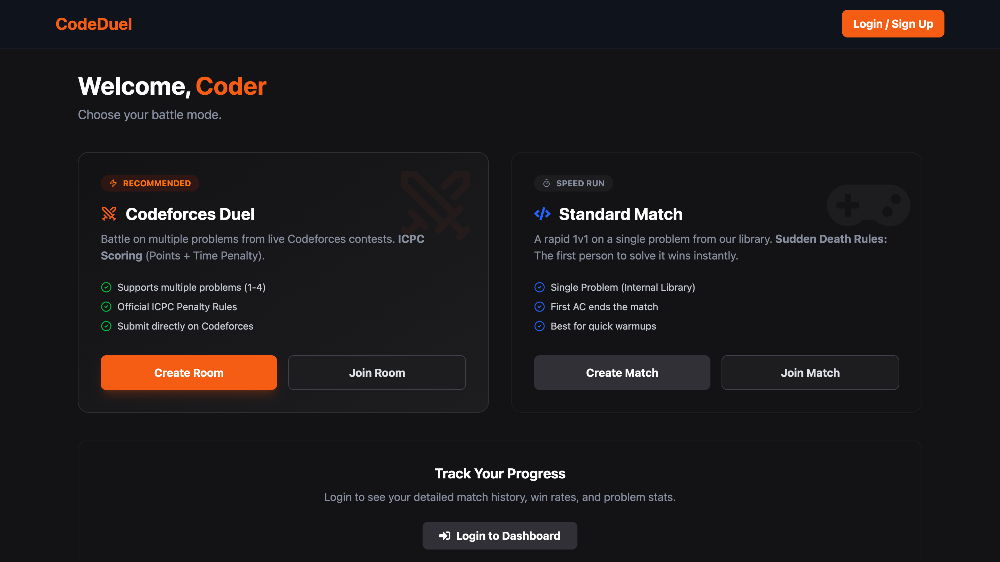
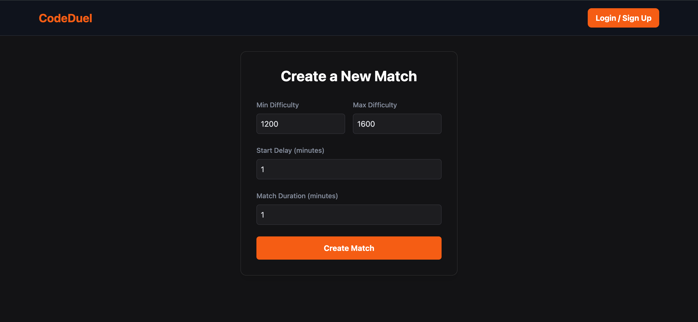
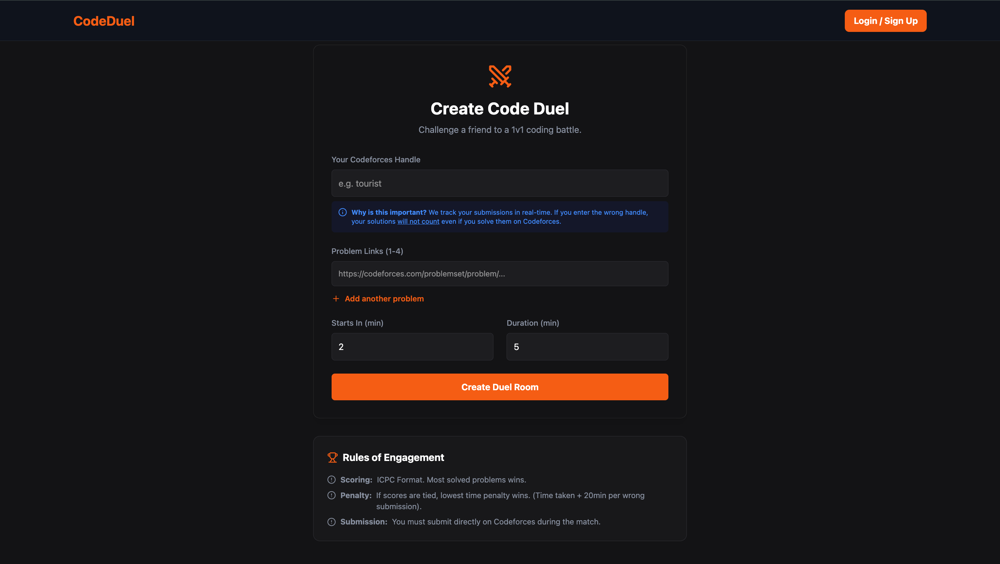
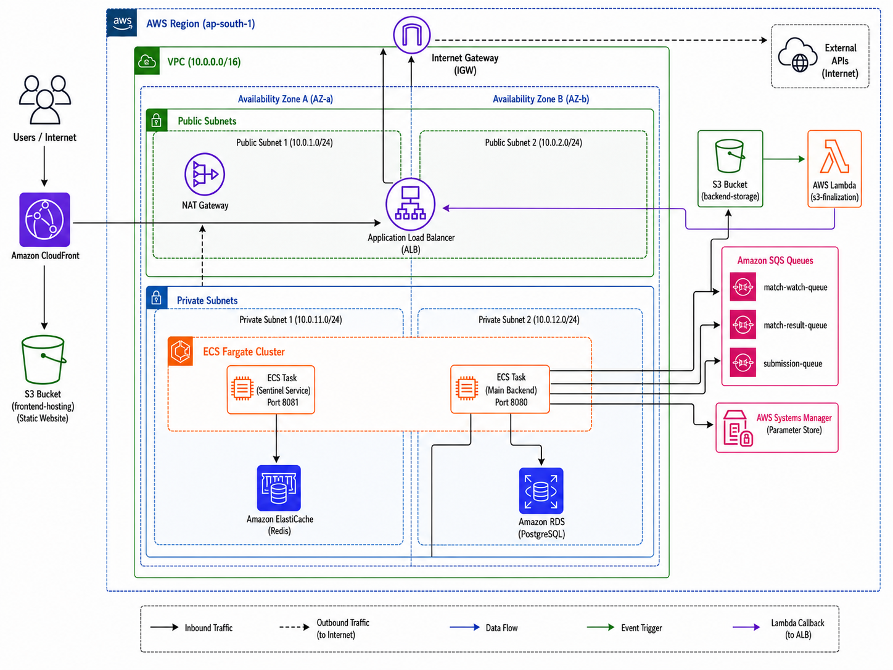
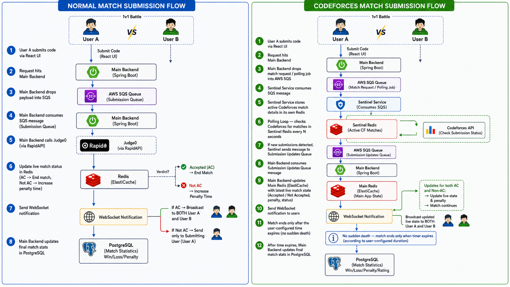
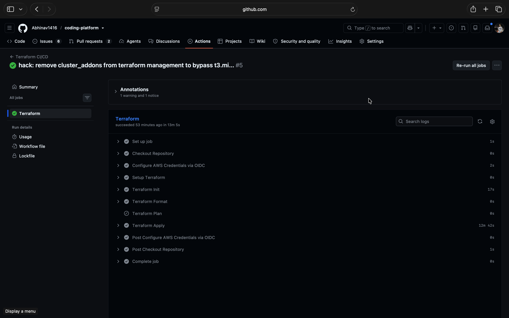
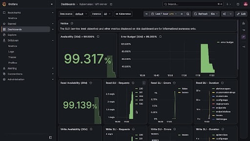
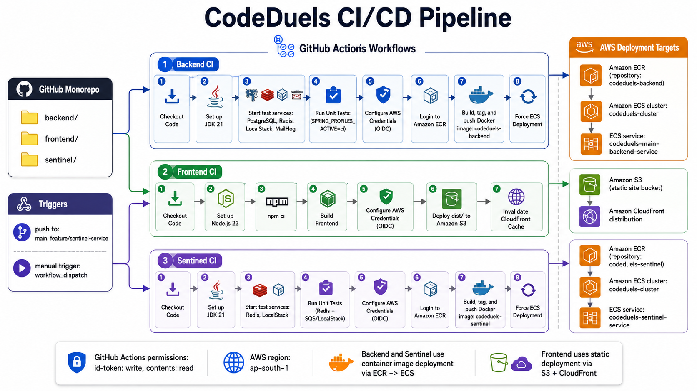

# CodeDuels — Real-Time 1v1 Competitive Programming Platform

CodeDuels is a full-stack platform for real-time, one-on-one DSA battles, with matchmaking, code execution, live verdict updates, and performance tracking. It has served **5,000+ registered users** and evolved from a manually deployed EC2 application to an **AWS EKS, Terraform, and GitOps-based architecture**.

> The project explores asynchronous event processing, WebSockets, microservices, Infrastructure as Code, CI/CD, Kubernetes autoscaling, and cloud security.

**[Gameplay & architecture demo](https://www.youtube.com/watch?v=nctT-6Y0xJg)** · **[Frontend preview](https://coding-platform-uyo1.vercel.app/home)** *(backend currently paused)* · **[Repository](https://github.com/Abhinav1416/coding-platform/)**

> **Deployment status:** The live AWS environment is paused to control costs. Infrastructure is provisioned with Terraform and can be brought up on demand. The frontend preview may load without a working backend.

## Contents

- [Highlights](#highlights)
- [Screenshots and diagrams](#screenshots-and-diagrams)
- [Architecture and system evolution](#architecture-and-system-evolution)
- [Backend services](#backend-services)
- [Asynchronous submission flows](#asynchronous-submission-flows)
- [Infrastructure and networking](#infrastructure-and-networking)
- [GitOps, security, and CI/CD](#gitops-security-and-cicd)
- [Cost strategy](#cost-strategy)
- [Features](#features)
- [Testing and reliability](#testing-and-reliability)
- [Tech stack](#tech-stack)
- [Local development](#local-development)
- [Star history](#star-history)

## Highlights

- **2,000+ registered users** and live 1v1 coding battles with matchmaking and WebSocket updates.
- Two asynchronous workflows: Judge0 execution for normal matches and a dedicated Sentinel worker for Codeforces matches.
- AWS SQS for decoupled job processing; Redis for live match state; PostgreSQL for durable storage.
- Terraform-managed AWS infrastructure, with more than 50 resources in the EKS phase and a documented 54-resource ECS phase.
- EKS deployment using Argo CD GitOps, Spot capacity (designed for a stated 90% compute-cost reduction), and KEDA queue-driven autoscaling.
- Separate CI/CD workflows for the frontend, Main Backend, and Sentinel Service.
- Google OAuth/JWT authentication, RBAC/ABAC, SSM-backed secrets, and private networking.

## Screenshots and diagrams

### Platform

<table>
  <tr>
    <th align="center">Home page</th>
    <th align="center">Normal match</th>
    <th align="center">Codeforces match</th>
  </tr>
  <tr>
    <td align="center" width="33%"></td>
    <td align="center" width="33%"></td>
    <td align="center" width="33%"></td>
  </tr>
</table>

### Architecture, workflows, and operations

<table>
  <tr>
    <th align="center">Architecture</th>
    <th align="center">Submission flow</th>
  </tr>
  <tr>
    <td align="center" width="50%"></td>
    <td align="center" width="50%"></td>
  </tr>
</table>

<table>
  <tr>
    <th align="center">Terraform CI/CD</th>
    <th align="center">KEDA autoscaling</th>
  </tr>
  <tr>
    <td align="center" width="50%"></td>
    <td align="center" width="50%"></td>
  </tr>
</table>

**CI/CD pipeline:**



## Architecture and system evolution

### Current phase: AWS EKS and GitOps

CloudFront serves the frontend from S3 and routes `/api` and `/ws` traffic to an Application Load Balancer. The ALB forwards requests to the Main Backend in EKS. SQS decouples long-running submission work from user-facing requests; KEDA scales queue-driven worker workloads based on queue depth. Redis holds live match state, and PostgreSQL stores durable data. The Sentinel Service polls Codeforces independently and publishes detected updates to a second SQS queue.

### Evolution

1. **Phase 1 — EC2 monolith:** Initial AWS Console-based setup with a backend running on EC2.
2. **Phase 2 — ECS Fargate:** Terraform-managed networking and services, S3/CloudFront hosting, RDS PostgreSQL, ElastiCache Redis, Sentinel, SSM Parameter Store, and separate GitHub Actions workflows. The [`ecs-fargate` branch](https://github.com/Abhinav1416/coding-platform/tree/ecs-fargate) contains this phase's architecture and documentation. That phase's documentation describes 54 AWS resources and local Terraform state.
3. **Phase 3 — EKS and GitOps:** Amazon EKS, Spot Instances, Argo CD, KEDA, IRSA, External Secrets Operator (ESO), and S3 remote Terraform state with DynamoDB locking.

The phases show the progression from manual deployment to repeatable infrastructure, separated services, declarative deployment, and queue-driven autoscaling.

## Backend services

### Main Backend

**Stack:** Java 21, Spring Boot 3, Spring Security, Spring Data JPA, Spring WebSockets, STOMP.

- Handles REST APIs, Google OAuth/JWT authentication, matchmaking, match lifecycle, user statistics, and problem workflows.
- Maintains STOMP/WebSocket connections for live updates.
- Queues submission and Codeforces tracking jobs in SQS, processes normal-match Judge0 results, and consumes Sentinel updates.
- Updates live match state in Redis and broadcasts results to both players.
- The EKS configuration uses JVM memory tuning including `-XX:+UseSerialGC` and `-XX:MaxRAMPercentage=65.0`.

### Sentinel Service

**Stack:** Java 21, Spring Boot 3, Spring Cloud AWS, SQS, Redis, Codeforces API.

- Consumes Codeforces match/polling jobs from SQS.
- Tracks active matches in its own Redis store and periodically polls the Codeforces API.
- Publishes newly detected verdicts to a separate SQS Submission Updates Queue for the Main Backend to process.

This keeps continuous third-party polling outside the user-facing API path.

### Frontend

**Stack:** React, Vite, TypeScript, Tailwind CSS, Monaco Editor, STOMP.js/SockJS.

Provides authentication, matchmaking, the duel and code-editor interface, live submission results, and profile statistics. GitHub Actions builds the frontend; AWS S3 and CloudFront host and deliver it when the AWS environment is active.

## Asynchronous submission flows

### Normal match — Judge0

1. A player submits code from the Monaco editor.
2. The Main Backend validates the user, match state, problem constraints, language, and code, then stores or updates relevant submission/match state.
3. It places the submission payload on the SQS Submission Queue and returns an immediate response rather than waiting for execution.
4. The backend's asynchronous processing path calls Judge0 through RapidAPI.
5. The result (verdict, runtime, memory usage, and any error details) updates the live match state in Redis.
6. WebSockets broadcast the verdict to both players; the frontend refreshes the duel view.
7. Final match statistics are persisted in PostgreSQL.

### Codeforces match — Sentinel polling

1. A player submits a solution during a Codeforces duel; the Main Backend validates the user, match state, and duel configuration.
2. The backend places a polling job on the SQS Codeforces Match Queue.
3. Sentinel consumes the job, tracks the active match in its own Redis store, and periodically polls the Codeforces API.
4. When it detects a new verdict or relevant submission update, Sentinel publishes a message to the SQS Submission Updates Queue.
5. The Main Backend consumes the update, refreshes the primary Redis match state, and broadcasts the result over WebSockets.
6. The frontend updates both players' views, and final match statistics are persisted in PostgreSQL.

**Why SQS:** Durable asynchronous messaging prevents long-running Judge0 execution and repeated Codeforces polling from blocking user-facing API requests, and helps absorb bursts of submissions.

## Infrastructure and networking

### Terraform

Terraform provisions the AWS environment. The EKS phase manages **50+ resources**, including:

- VPC, public/private/isolated subnets, route tables, Internet Gateway, NAT Gateway, and Elastic IP.
- EKS cluster and managed node groups; Application Load Balancer and target groups.
- IAM roles, policies, and OIDC providers; SQS queues and S3 buckets.
- CloudFront distribution with Origin Access Control (OAC), RDS PostgreSQL, and ElastiCache Redis.
- Across the documented phases: Lambda functions and permissions, CloudWatch log groups, and (in Phase 2) ECS clusters, task definitions, and services.

The EKS phase uses **S3 remote state with DynamoDB locking** for shared, concurrent Terraform workflows. The earlier ECS phase is documented as using local state and managing 54 AWS resources. Terraform is parameterized by variables, for example `-var="env=prod"`, so the configuration can be adapted to different environments.

### Network topology

- **Edge:** CloudFront serves static files from S3 and routes `/api` and `/ws` requests to the ALB.
- **Public subnets:** The ALB receives inbound traffic; NAT provides outbound access for backend services to Google OAuth, Judge0, and Codeforces APIs.
- **Private subnets:** ECS tasks in Phase 2 / EKS worker nodes in Phase 3 run backend workloads without public IPs.
- **Isolated subnets:** RDS PostgreSQL and ElastiCache Redis are not publicly accessible and accept traffic only from approved backend security groups.

## GitOps, security, and CI/CD

### GitOps with Argo CD

In the EKS phase, Argo CD runs in the cluster and watches the repository's `k8s/` directory. Changes to Kubernetes Deployments, ConfigMaps, and Services are synchronized from Git, keeping the declared repository state aligned with the cluster. CI builds and publishes images; Argo CD handles Kubernetes deployment synchronization.

### Credentials and runtime secrets

- **GitHub Actions:** Uses OIDC to assume a temporary AWS IAM role for operations such as ECR pushes and Terraform state changes; AWS credentials are not hardcoded in the repository.
- **EKS runtime:** Kubernetes ServiceAccounts use IAM Roles for Service Accounts (IRSA). External Secrets Operator (ESO) retrieves database credentials and API keys from AWS SSM Parameter Store and exposes them to pods as Kubernetes Secrets.
- **ECS phase:** ECS task IAM roles and SSM Parameter Store provide runtime access to secrets.
- IAM policies follow least-privilege principles. S3 frontend access is restricted through CloudFront OAC.

### CI/CD workflows

| Workflow | Build and release steps |
| --- | --- |
| Frontend | Install dependencies, build the React app, sync `dist/` to S3, and invalidate CloudFront. |
| Main Backend | Run Gradle tests, build a Docker image, and push it to Amazon ECR. ECS phase: update the ECS service; EKS phase: Argo CD syncs Kubernetes manifests from Git. |
| Sentinel Service | Run Gradle tests, build a Docker image, and push it to Amazon ECR. ECS phase: update the ECS service; EKS phase: Argo CD syncs Kubernetes manifests from Git. |

The workflows allow the frontend, Main Backend, and Sentinel Service to be built and tested independently within the monorepo.

## Cost strategy

The AWS environment is intentionally not presented as continuously available. Terraform supports on-demand creation and teardown (`terraform destroy`) when the infrastructure is not needed.

- **EKS:** Spot Instances reduce compute costs; KEDA can scale queue-driven worker workloads to zero when SQS queues are empty.
- **Lifecycle:** Create the environment for demos/testing, then destroy or pause unused resources such as NAT Gateways, clusters, databases, and caches to avoid unnecessary charges.
- **ECS phase:** Fargate services and RDS can be scaled down, stopped, or recreated as appropriate for testing.

## Features

**Player features**
- Google OAuth login and JWT authentication.
- 1v1 duels, match-room creation/joining, difficulty-based problem selection, match timer, and automatic completion.
- Monaco editor with C++, Java, and Python support.
- Live submission status and verdicts; user statistics and performance tracking.

**Admin and problem-setter features**
- RBAC for admin/problem-setter workflows and ABAC for granular permissions.
- Problem metadata creation and permission-based publishing.
- Direct hidden-test uploads to S3 using pre-signed URLs, followed by Lambda-based event processing.

**Platform features**
- SQS-based asynchronous code execution and Codeforces tracking.
- STOMP/WebSocket real-time communication, Redis live state, PostgreSQL persistence, and CloudWatch logging.
- Terraform-managed infrastructure, independent CI/CD workflows, and SSM-backed secret management.

## Testing and reliability

**Tools:** JUnit 5, Mockito, Spring Boot Test.

- **Main Backend:** Authentication, matchmaking, WebSocket broadcasting, repository constraints, submission orchestration, Judge0 result handling, and SQS processing.
- **Sentinel:** Polling-job consumption, active-match tracking in Redis, Codeforces response handling, and SQS update publishing.
- Approximately **15–20 core test classes** cover key paths across both backend services.

Reliability measures include asynchronous queue processing, Redis for real-time state with PostgreSQL as durable storage, direct S3 uploads to avoid routing large test-case files through the backend, and transactional boundaries around match creation, submission handling, and match completion.

**Authentication note:** 2FA exists in backend code but is not active in the deployed frontend, so it is not listed as a live user-facing feature.

## Tech stack

| Area | Technologies |
| --- | --- |
| Frontend | React, Vite, TypeScript, Tailwind CSS, Monaco Editor, STOMP.js/SockJS |
| Backend | Java 21, Spring Boot 3, Spring Security, Spring Data JPA, Spring WebSockets |
| Worker | Spring Cloud AWS, AWS SQS, Redis, Codeforces API |
| Compute and orchestration | Amazon EKS, Kubernetes, AWS ECS Fargate (Phase 2), Spot Instances, KEDA, Argo CD, External Secrets Operator |
| Data and messaging | Amazon RDS PostgreSQL, ElastiCache Redis, AWS SQS |
| Cloud and networking | VPC, subnets, ALB, NAT Gateway, security groups, ECR, S3, CloudFront/OAC, Lambda, CloudWatch |
| Infrastructure and delivery | Terraform, GitHub Actions, S3 remote state and DynamoDB locking (EKS phase) |
| Security and secrets | Google OAuth, JWT, RBAC/ABAC, IAM, OIDC, IRSA, AWS SSM Parameter Store |
| Testing | JUnit 5, Mockito, Spring Boot Test |
| Code execution | Judge0 API via RapidAPI |

## Local development

### Prerequisites

- Java 21 and Gradle
- Node.js and npm
- Docker
- PostgreSQL and Redis
- Kubernetes with Kind or Minikube if testing Kubernetes manifests locally

### Clone the repository

```bash
git clone https://github.com/Abhinav1416/coding-platform.git
cd coding-platform
```

Set the following environment variables for the relevant services. Keep actual credentials in local environment files or a secret manager; do not commit secrets.

**Frontend**

```env
VITE_API_BASE_URL=
VITE_WS_BASE_URL=
```

**Main Backend**

```env
SPRING_DATASOURCE_URL=
SPRING_DATASOURCE_USERNAME=
SPRING_DATASOURCE_PASSWORD=
JWT_SECRET=
GOOGLE_CLIENT_ID=
GOOGLE_CLIENT_SECRET=
REDIS_HOST=
REDIS_PORT=
AWS_REGION=
SQS_SUBMISSION_QUEUE_URL=
SQS_CODEFORCES_MATCH_QUEUE_URL=
SQS_SUBMISSION_UPDATES_QUEUE_URL=
JUDGE0_API_URL=
JUDGE0_API_KEY=
```

**Sentinel Service**

```env
AWS_REGION=
SQS_CODEFORCES_MATCH_QUEUE_URL=
SQS_SUBMISSION_UPDATES_QUEUE_URL=
REDIS_HOST=
REDIS_PORT=
CODEFORCES_API_BASE_URL=
```

In AWS, runtime secrets are retrieved through SSM Parameter Store using the relevant task or pod IAM role. See the `k8s/` directory for Kubernetes manifests and ConfigMaps; match environment values to your local Docker/Kubernetes setup before applying them.

## Star history

[](https://star-history.com/#Abhinav1416/coding-platform&Date)
